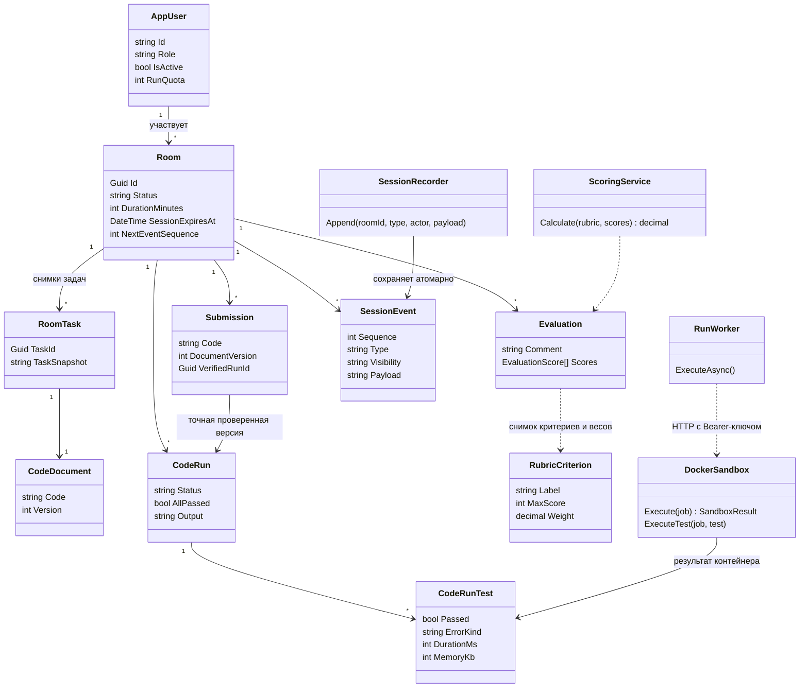
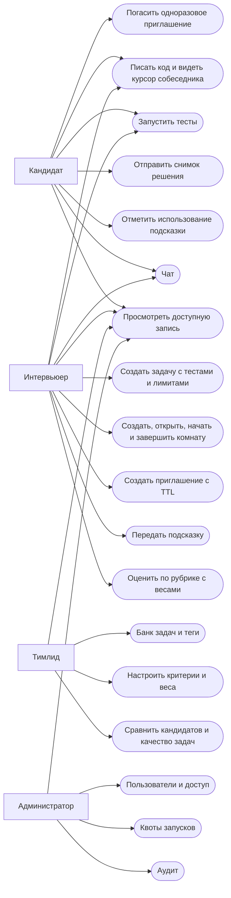
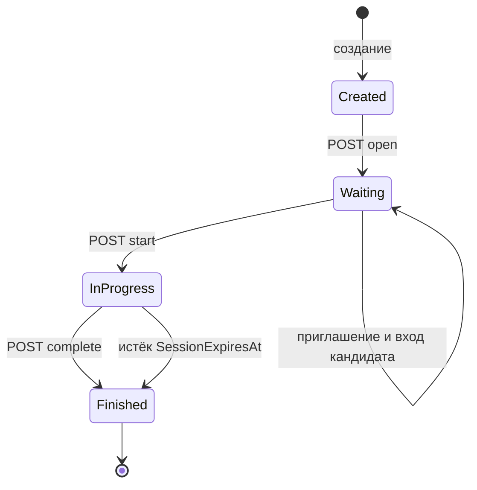
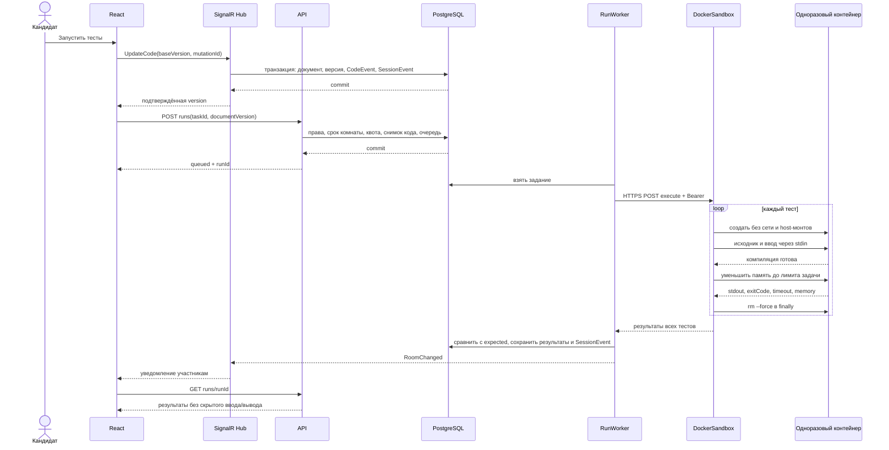
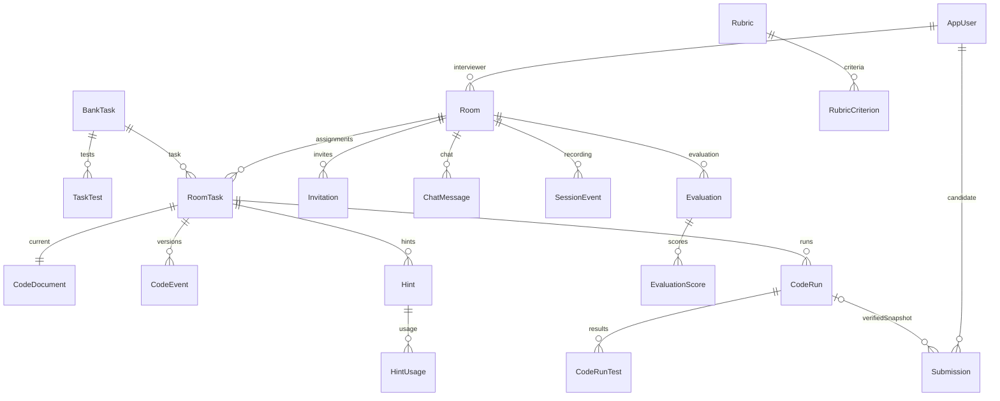

# UML платформы технических интервью

Диаграммы соответствуют реализованному коду. `DockerSandbox` выполняет роль
CodeRunner и находится в отдельном процессе `Interview.Runner`.

## Диаграмма классов

## Use Case по ролям

## Состояния комнаты

В БД значения называются `draft`, `waiting`, `active`, `completed`.
Для совместимости со старым клиентом API допускает `start` сразу из `draft`;
новый интерфейс использует полный путь через Waiting. Таймер начинает отсчёт
при переходе в InProgress. После окончания сервер запрещает изменения кода,
новые запуски, чат и подсказки. Запись и оценки остаются доступны по правам.

## Последовательность запуска тестов

## Связи основных сущностей БД

Полный SQL, включая Identity, индексы, ограничения и историю миграций,
находится в `backend/database/initial-schema.sql`. После обновления таблиц — 29.
