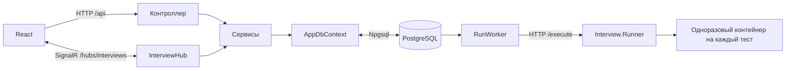

# Как устроен API: классы, методы и движение данных

Справочник составлен по текущим исходникам `backend/Interview.Api` и `backend/Interview.Runner`. Он объясняет собственные классы и методы проекта, включая закрытые вспомогательные методы. Встроенные методы ASP.NET, EF Core и Identity объясняются там, где они используются. Тестовые классы не являются частью работающего API; описание проверок находится в `REQUIREMENTS_CHECK.md`.

## 1. Сначала общая картина



Например, кандидат нажал «Отправить решение»:

1. React отправил `POST /api/rooms/{id}/submissions`.
2. ASP.NET проверил cookie, лимит запросов и CSRF-токен.
3. `SolutionsController.Submit` проверил роль кандидата, доступ к комнате и версию кода.
4. `AppDbContext` подготовил запись `Submission`.
5. `SessionRecorder.Append` добавил событие отправки в журнал и сохранил изменения.
6. Транзакция завершилась; `RoomConnections.Changed` отправил уведомление участникам.
7. `DtoService.Room` собрал ответ для браузера.

### Как читать обозначения C#

| Обозначение | Что означает в проекте |
|---|---|
| `class` | Класс: хранит данные, выполняет действия либо делает и то и другое. |
| `record` | Тип для передачи набора данных. Здесь это в основном запросы и ответы API. |
| `public` | Метод доступен другим классам; в контроллере маршрут задаётся отдельным атрибутом. |
| `private` | Метод используется внутри своего класса. Самостоятельного HTTP-маршрута у него нет. |
| `protected override` | Переопределение метода базового класса, например фонового `ExecuteAsync`. |
| `static` | Метод вызывается через имя класса без создания отдельного экземпляра. |
| `async` / `await` | Позволяют ждать БД, сеть и другие операции без блокировки потока на всё время ожидания. |
| `Task<T>` | Будущий результат операции типа `T`. Это не задача собеседования: она называется `BankTask`. |
| `Guid` | Идентификатор UUID. Пользовательские ID Identity в этом проекте имеют тип `string`. |
| `?` после типа | Значение может отсутствовать: `Guid?`, `DateTime?`, `string?`. |
| `=>` | Короткая запись метода, свойства или функции. |
| `x => x.RoomId == id` | Условие для выборки; EF Core обычно переводит такое выражение в SQL. |
| `db.SaveChangesAsync()` | Отправляет накопленные изменения отслеживаемых объектов в БД. |
| `BeginTransactionAsync()` / `CommitAsync()` | Начать и подтвердить группу связанных изменений. При выходе без подтверждения изменения транзакции откатываются. |
| `using` / `await using` | Освободить ресурс после выхода из блока: соединение, транзакцию, поток и т. п. |

Запись `class AccessService(AppDbContext db)` — конструктор в заголовке класса. ASP.NET создаёт объект и передаёт туда `db` через механизм внедрения зависимостей, DI. Параметры конструктора — зависимости класса, а не поля HTTP-запроса.

## 2. Program.cs — запуск основного приложения

Файл: `backend/Interview.Api/Program.cs`.

В нём используются инструкции верхнего уровня: отдельный написанный вручную `Main` не нужен. Этот файл собирает приложение и задаёт порядок обработки запросов.

### Создание и регистрация сервисов

| Блок | Что делает |
|---|---|
| `WebApplication.CreateBuilder(args)` | Читает конфигурацию приложения, окружение и аргументы запуска; создаёт контейнер сервисов. |
| Обработка `--create-keyring-certificate` | Создаёт сертификат для защиты ключей через `KeyringCertificate.Create` и завершает процесс до подключения БД. |
| `AddDataProtection` | Задаёт общее имя приложения и постоянную папку ключей. В Windows использует DPAPI, при указанном PFX — сертификат. В Linux Production без PFX запуск запрещён. |
| `Configure<ForwardedHeadersOptions>` | Разрешает принимать адрес клиента и схему HTTP/HTTPS от явно перечисленных доверенных прокси. |
| `ConfigureKestrel` | Ограничивает тело HTTP-запроса основного API размером 256 КиБ. |
| `GetConnectionString("Database")` | Берёт строку подключения из конфигурации. В рабочем режиме отсутствие строки вызывает ошибку запуска. |
| `AddDbContext` / `UseNpgsql` | Подключает EF Core к PostgreSQL через провайдер Npgsql. |
| `AddIdentity` | Подключает учётные записи, пароли и роли. Email уникален, пароль от 8 символов; после 5 неудачных входов действует блокировка на 15 минут. |
| `ConfigureApplicationCookie` | Настраивает cookie `interview.session`: HttpOnly, срок 8 часов без продления, Secure в Production. |
| `AddAntiforgery` | Настраивает CSRF-cookie и заголовок `X-CSRF-Token`. |
| `AddControllers` | Подключает контроллеры и общий `CsrfFilter`. |
| `AddSignalR` | Подключает real-time; ограничивает входящее сообщение размером 256 КиБ, отключает подробные ошибки сервера для клиентов. |
| `AddHttpClient("runner")` | Создаёт HTTP-клиент исполнителя: адрес из конфигурации, таймаут 180 секунд, автоматические перенаправления отключены. В Production адрес должен использовать HTTPS. |
| `AddRateLimiter` | Общий лимит: 200 запросов в минуту на пользователя либо IP. Для действий с политикой `auth`: 10 в минуту на IP. При отказе возвращается 429. |

Сроки жизни зависимостей:

- `AddScoped`: `AppDbContext`, `AccessService`, `DtoService`, `RunService`, `SessionRecorder`, `CsrfFilter`. Экземпляр живёт в рамках области обработки; фоновые службы создают области отдельно. Экземпляр Hub/его область не следует считать постоянным на всё WebSocket-соединение.
- `AddSingleton`: `FieldCipher`, `RoomConnections`. Один экземпляр на процесс приложения.
- `AddHostedService`: `RunWorker`, `RoomExpiryWorker`. ASP.NET запускает их в фоне вместе с приложением.

### Обработчики cookie

`OnRedirectToLogin` вместо HTML-редиректа возвращает **401**. React получает понятный HTTP-статус.

`OnRedirectToAccessDenied` возвращает **403**, если прав недостаточно.

`OnValidatePrincipal` находит пользователя и сравнивает его `SecurityStamp` с отметкой в cookie. Неактивная учётная запись или несовпадение отметки делает cookie недействительной. `SecurityStamp` — служебная отметка Identity для отзыва ранее выданных сеансов.

### Последовательность middleware

Middleware — обработчик, через который проходит запрос. Вызов `next()` передаёт его следующему обработчику.

1. Доверенные `ForwardedHeaders`, если они настроены.
2. HSTS и перенаправление на HTTPS вне Development/Testing.
3. Обработчик заголовков безопасности и исключений. `ApiError` превращается в заданный статус и `{ detail }`; конфликт версий — в 409; нарушение уникальности PostgreSQL — в 409; непредвиденная ошибка — в 500 без внутреннего текста исключения в браузере.
4. Проверка `Origin` для `/hubs`: защищает cookie-соединение SignalR от открытия посторонним сайтом.
5. `UseAuthentication`: узнаёт пользователя по cookie.
6. `UseAuthorization`: проверяет требование авторизации.
7. `UseRateLimiter`: ограничивает частоту запросов.
8. Маршруты контроллеров, Hub и health-проверок.

`GET /health/live` сообщает, что процесс работает. `GET /health/ready` дополнительно вызывает `Database.CanConnectAsync()` и проверяет доступность БД.

### Команды обслуживания

| Команда | Что происходит |
|---|---|
| `--migrate` | Применяются EF-миграции, создаются отсутствующие роли; затем процесс завершается. |
| `--bootstrap-admin` | Создаётся первый администратор из конфигурации; затем процесс завершается. |
| `--encrypt-existing-data` | Выполняется перенос старых данных через `EncryptionBackfill.Run`; затем процесс завершается. |
| Обычный запуск | Проверяются/создаются роли, затем `app.RunAsync()` запускает обслуживание запросов. Миграции автоматически не применяются. |

## 3. Контроллеры — входящие HTTP-запросы

`[ApiController]` включает поведение API, в том числе проверку входных моделей с атрибутами. `[Authorize]` требует входа; `[AllowAnonymous]` разрешает конкретное действие без входа. При этом CSRF-фильтр продолжает действовать для изменяющих HTTP-запросов.

Параметры `id` берутся из пути, `[FromQuery]` — из строки после `?`, объекты `...Request` — из JSON. Результат сериализуется в JSON с именами свойств в camelCase.

### AuthController — вход, регистрация и приглашения

Файл: `Controllers/AuthController.cs`. Зависимости: БД, `UserManager`, `SignInManager`, проверка доступа и построение DTO.

| Метод | Маршрут / вызов | Как работает |
|---|---|---|
| `NewToken()` | Внутренний static | Создаёт 32 криптографически случайных байта и превращает их в шестнадцатеричную строку. Используется для приглашений и установки пароля. |
| `HashToken(token)` | Внутренний static | Возвращает SHA-256-хеш токена. Именно хеш сохраняется в БД. |
| `IdentitySucceeded(result)` | Внутренний static | Проверяет результат операции Identity; при ошибке выбрасывает `ApiError(400, ...)`. |
| `Csrf(antiforgery)` | `GET /api/auth/csrf` | Создаёт/выдаёт защитный токен, устанавливает служебную cookie. Браузер передаёт токен в заголовке изменяющих запросов. |
| `Me()` | `GET /api/auth/me` | Загружает активного пользователя через `access.Actor` и возвращает безопасный `UserDto`. |
| `Register(request)` | `POST /api/auth/register/candidate` | Создаёт только кандидата с квотой 10, назначает роль Identity, записывает аудит и после подтверждения транзакции выдаёт cookie входа. Регистрация не назначает комнату. |
| `Login(request)` | `POST /api/auth/login` | Ищет активного пользователя по email, проверяет пароль через Identity с учётом блокировок, записывает аудит и выдаёт данные пользователя. Cookie создаёт `PasswordSignInAsync`. |
| `Logout(connections)` | `POST /api/auth/logout` | Отзывает real-time-соединения пользователя через `Revoke`, удаляет cookie входа через `SignOutAsync`, возвращает 204 без JSON-тела. |
| `Redeem(request)` | `POST /api/invitations/redeem` | Хеширует токен, блокирует приглашение и комнату в транзакции; проверяет TTL, одноразовость и доступность комнаты. Привязывает вошедшего кандидата или создаёт гостевого кандидата без пароля. Помечает токен использованным, пишет событие и аудит, выдаёт cookie, уведомляет участников. |
| `SetupPassword(request)` | `POST /api/auth/setup-password` | Проверяет одноразовую ссылку сотрудника, срок, активность и отсутствие уже установленного пароля. Устанавливает пароль через Identity, погашает ссылку и выполняет вход. Это не общий сброс забытого пароля. |

Транзакции нужны, например, чтобы два параллельных запроса не использовали одно приглашение дважды.

### AdminController — управление сотрудниками

Файл: `Controllers/AdminController.cs`. Общий префикс `/api/admin`.

| Метод | Маршрут / вызов | Как работает |
|---|---|---|
| `Admin()` | Закрытый helper | Получает текущего пользователя и требует роль `admin`. Его вызывают остальные методы класса. |
| `Users()` | `GET /api/admin/users` | Читает пользователей из БД и преобразует каждого в `UserDto`. |
| `Create(request)` | `POST /api/admin/users` | Создаёт интервьюера, тимлида или администратора без пароля, с квотой 30. Под блокировкой проверяет лимит активных тимлидов. Создаёт ссылку установки пароля на сутки; возвращает исходный токен только в ответе создания. |
| `Update(id, request)` | `PATCH /api/admin/users/{id}` | Меняет активность и/или квоту. Запрещает отключить себя и последнего активного администратора; проверяет лимит при включении тимлида. При смене активности обновляет security stamp; при отключении отзывает соединения SignalR. Роль этим методом не меняется. |
| `Audit()` | `GET /api/admin/audit` | Возвращает последние 100 событий административного аудита, новые первыми. |
| `History(id, afterVersion, taskId)` | `GET /api/admin/rooms/{id}/code-history` | Требует `taskId`, записывает факт просмотра в аудит, возвращает до 200 версий кода после `afterVersion`. |

### CatalogController — банк задач и рубрики

Файл: `Controllers/CatalogController.cs`.

| Метод | Маршрут / вызов | Как работает |
|---|---|---|
| `Staff()` | Закрытый helper | Допускает роли `interviewer` и `teamlead`. Администратор не получает эти права автоматически. |
| `Tasks()` | `GET /api/tasks` | Загружает банк вместе с тестами; возвращает DTO задач. Доступ только сотрудникам указанных ролей, поэтому здесь могут быть скрытые тесты. |
| `CreateTask(request)` | `POST /api/tasks` | Создаёт `BankTask`, назначает текущего автора, вызывает `ApplyTask`, записывает задачу и аудит. |
| `UpdateTask(id, request)` | `PUT /api/tasks/{id}` | Разрешает изменение автору или тимлиду. Блокирует задачу, удаляет старые тесты, добавляет новые, увеличивает `Version`; всё проходит в одной транзакции. Снимки в ранее созданных интервью не переписываются. |
| `ApplyTask(task, request)` | Закрытый static | Проверяет язык, сложность, теги и содержимое тестов; копирует поля запроса в сущность, убирает повторные теги, назначает тестам последовательные позиции. Самостоятельно БД не сохраняет. |
| `Rubrics()` | `GET /api/rubrics` | Загружает шаблоны оценивания вместе с критериями. |
| `CreateRubric(request)` | `POST /api/rubrics` | Дополнительно требует тимлида. Проверяет уникальные ключи, названия, максимальные баллы и положительные веса критериев. Создаёт рубрику, критерии и аудит. |

### RoomsController — проведение интервью

Файл: `Controllers/RoomsController.cs`. Общий префикс `/api/rooms`.

| Метод | Маршрут | Как работает |
|---|---|---|
| `List()` | `GET /api/rooms` | Кандидату возвращает его комнаты, интервьюеру — его собственные. Данные каждой комнаты собирает `DtoService.Room`. |
| `Create(request)` | `POST /api/rooms` | Только интервьюер. Проверяет задачи и рубрику; создаёт комнату, копии задач/рубрик и начальные документы кода. Пишет `RoomCreated` и аудит; подтверждает транзакцию. |
| `Get(id)` | `GET /api/rooms/{id}` | Проверяет доступ и выдаёт состояние комнаты. |
| `Document(id, taskId)` | `GET /api/rooms/{id}/documents/{taskId}` | Проверяет доступ и возвращает текущий код, язык и номер версии выбранной задачи. |
| `Open(id)` | `POST /api/rooms/{id}/open` | Владелец-интервьюер переводит `draft` в `waiting`; записывает событие и уведомляет участников. |
| `Start(id)` | `POST /api/rooms/{id}/start` | Переводит `draft` или `waiting` в `active`. Фиксирует начало и вычисляет срок окончания из `DurationMinutes`. |
| `Complete(id)` | `POST /api/rooms/{id}/complete` | Завершает активную, ещё не истёкшую комнату; устанавливает `CompletedAt`, пишет событие и аудит. Истёкшие комнаты завершает фоновая служба. |
| `Invite(id)` | `POST /api/rooms/{id}/invitations` | Для открытой комнаты без кандидата создаёт приглашение на час. Предыдущие неиспользованные ссылки комнаты делает просроченными. В БД пишет хеш; исходный токен возвращает клиенту. |
| `Message(id, request)` | `POST /api/rooms/{id}/messages` | Для активной комнаты добавляет сообщение чата и событие; уведомляет участников о новом состоянии. |
| `Hint(id, request)` | `POST /api/rooms/{id}/hints` | Интервьюер добавляет подсказку к назначенной задаче активной комнаты. Создаёт `Hint`, событие и аудит. |
| `HintUsage(id, request)` | `POST /api/rooms/{id}/hint-usage` | Участник отмечает использование существующей подсказки кандидатом комнаты. Повторное нажатие не создаёт повторную отметку. |
| `Evaluate(id, request)` | `POST /api/rooms/{id}/evaluations` | Интервьюер проверяет баллы по снимку рубрики комнаты, создаёт или заменяет свою оценку, сохраняет комментарий и баллы. В журнал пишет событие с видимостью `staff`. Оценивание не требует активной комнаты, поэтому возможно и после завершения. |

Снимки `TaskSnapshot` и `RubricSnapshot` нужны, чтобы последующее исправление банка или шаблона не меняло условия уже созданного интервью.

### SolutionsController — тесты и отправка решения

Файл: `Controllers/SolutionsController.cs`. Префикс `/api/rooms/{id}`.

| Метод | Маршрут | Как работает |
|---|---|---|
| `Run(id, request)` | `POST .../runs` | Проверяет пользователя/доступ и передаёт постановку задания в `RunService.Create`. Не ждёт исполнения всех тестов; возвращает сведения о поставленном запуске. |
| `RunStatus(id, runId)` | `GET .../runs/{runId}` | Проверяет комнату, загружает запуск с результатами и преобразует его через `DtoService.Run`. Сам опрос не расходует квоту. |
| `Submit(id, request)` | `POST .../submissions` | Только кандидат активной комнаты. Проверяет сохранённую версию, создаёт неизменяемый снимок кода. При наличии успешной проверки этой версии указывает `VerifiedRunId`. Повторная отправка той же версии не создаёт дубликат. |

Решение можно отправить и без успешного запуска. Тогда оно сохранено, но не считается подтверждённым прохождением тестов. Если проверка этой версии успешно завершится позже, `RunWorker` свяжет её с решением.

### RecordingController — журнал и воспроизведение

Файл: `Controllers/RecordingController.cs`.

| Метод | Маршрут | Как работает |
|---|---|---|
| `List()` | `GET /api/recordings` | Возвращает до 200 комнат: тимлиду/администратору все, остальным — только комнаты, где они участники. |
| `Events(id, afterSequence, limit)` | `GET /api/rooms/{id}/events` | Возвращает следующую страницу событий по порядку. `limit` ограничивается диапазоном 1–200. Кандидату отбираются только события `participants`. `NextAfter` нужен для следующей страницы, `TotalSequence` — общий номер последнего события комнаты. |
| `State(id, atSequence)` | `GET /api/rooms/{id}/recording` | Проверяет позицию, для каждой задачи находит последнюю версию кода не позже этого события. Если её ещё нет, берёт стартовый код из снимка задачи. Возвращает восстановленные документы. |

Курсоры передаются в реальном времени, но не записываются в этот журнал. Воспроизведение показывает сохранённые состояния кода и события, не видео звонка.

### ReportsController — отчёты тимлиду

Файл: `Controllers/ReportsController.cs`.

`Get()` обрабатывает `GET /api/reports` и требует роль `teamlead`. Загружает комнаты, назначения задач, оценки, решения и подсказки. Возвращает:

- `Candidates`: строку на интервью с кандидатом, число отправленных версий, использованных подсказок, средний сырой балл и взвешенный итог.
- `Tasks`: число разных кандидатов, которым назначали задачу, число решивших её по подтверждённым снимкам и средний балл соответствующих интервью.

Внутри `Get` есть две локальные функции:

| Функция | Что делает |
|---|---|
| `Average(roomId)` | Берёт все численные баллы критериев комнаты и считает простое среднее. При отсутствии оценок возвращает `null`. |
| `Final(roomId)` | Находит оценку и снимок рубрики комнаты; передаёт их в `ScoringService.Calculate`. Это итог с учётом весов, в процентах. |

`AverageScore` и `FinalScore` имеют разные шкалы. Средний балл задачи сейчас относится к интервью целиком, а не к отдельной оценке решения именно этой задачи. Отчёт собирается в памяти; для больших объёмов его потребуется переводить в SQL-агрегации.

## 4. Сервисы — общая логика

### AccessService — проверки прав

Файл: `Services/AccessService.cs`.

| Метод | Назначение |
|---|---|
| `Actor(principal)` | Извлекает ID из подтверждённой личности ASP.NET, загружает активного пользователя из БД. При отсутствии входа/активности выбрасывает 401. Роль берётся с сервера. |
| `Role(actor, allowed)` | Проверяет, содержится ли роль пользователя среди разрешённых. При отказе — 403. |
| `Room(actor, roomId)` | Загружает комнату и допускает только назначенного кандидата либо её владельца-интервьюера. Не найдено — 404; чужая — 403. |
| `Expired(room)` | Возвращает `true`, если установленное время окончания уже наступило. |
| `Active(room)` | Требует одновременно `status == active` и неистёкший срок; иначе — 409. |
| `Invitable(room)` | Разрешает приглашение/его погашение для `waiting` или `active`, если время не истекло. |
| `RecordingRoom(actor, id)` | Для тимлида/администратора допускает просмотр записи любой комнаты; для остальных использует обычную проверку `Room`. |
| `Document(roomId, taskId)` | Ищет документ по паре комната/задача. При отсутствии — 404. Сам по себе не проверяет личность пользователя: вызывающий код должен проверить доступ к комнате. |
| `Audit(actor, action, entityId)` | Добавляет `AuditEvent` в отслеживаемые изменения. Сам `SaveChangesAsync` не вызывает: запись фиксирует вызывающий код. |

### DtoService — ответы, безопасные для браузера

Файл: `Services/DtoService.cs`. DTO — форма данных ответа, а не целая сущность БД.

| Член | Назначение |
|---|---|
| `Json` | Общие настройки JSON в веб-формате. |
| `Languages` | Множество семи разрешённых языков. |
| `Serialize<T>(data)` | Превращает объект в JSON-строку, например для снимка задачи или события. Само шифрование делает слой EF. |
| `Deserialize<T>(json)` | Восстанавливает типизированный объект из сохранённого JSON. |
| `Document(document)` | Выбирает для ответа ID задачи, язык, код и версию. |
| `Task(task)` | Собирает DTO задачи и сортирует тесты по `Position`. Сам скрытые тесты не фильтрует. |
| `Rubric(rubric)` | Собирает DTO рубрики с критериями в нужном порядке. |
| `User(user)` | Возвращает ID, имя, email, роль, активность, квоту. Для кандидата дополнительно ищет последнюю его комнату. Хеш пароля не возвращается. |
| `Room(room, actor)` | Загружает снимки задач, последние 100 сообщений, подсказки, отметки, оценки и сведения об отправленных решениях. Убирает скрытые тесты и оценки из ответа кандидату. Вычисляет `CanEditCode`, `CanSubmit`, `CanInterview` и отображаемый статус истёкшей комнаты. |
| `Run(run)` | Возвращает статус, краткий итог, разрешённый вывод и результаты по тестам. Переводит коды ошибок в понятные сообщения. |

`CanEditCode` означает, что состояние комнаты допускает редактирование. Право конкретного соединения сейчас писать дополнительно проверяет `RoomConnections`; одного этого флага недостаточно.

### RunService — постановка исполнения в очередь

Файл: `Services/RunService.cs`.

`Enabled` — вычисляемое свойство: настроены ли одновременно `Runner:BaseUrl` и `Runner:ApiKey`.

`Create(actor, roomId, request)`:

1. Проверяет доступ и активность комнаты, наличие настроенного runner.
2. Открывает транзакцию и берёт блокировки очереди, квоты пользователя и комнаты.
3. Проверяет номер версии документа.
4. Проверяет квоту, общий размер очереди меньше 100 и число незавершённых запусков пользователя меньше 2.
5. Находит/создаёт `DailyRunUsage` для текущей даты UTC и резервирует один запуск.
6. Создаёт `CodeRun` со снимком кода и статусом `queued`.
7. Записывает аудит и `RunQueued`, подтверждает транзакцию и возвращает запуск.

Резерв квоты не возвращается при ошибке runner. Иначе неудачные запросы позволяли бы бесконечно обходить ограничение.

### RunWorker — фоновая обработка очереди

Файл: `Services/RunWorker.cs`, наследуется от `BackgroundService`.

| Метод | Назначение |
|---|---|
| `ExecuteAsync(stoppingToken)` | Если runner не настроен, завершает работу. При старте помечает оставшиеся `running` прошлого процесса как `failed`. Затем вызывает `ExecuteOne`; когда заданий нет, ждёт секунду. Ошибки пишет в лог. |
| `ExecuteOne(cancellation)` | Берёт самый старый `queued`, ставит `running`, читает снимок задачи, отправляет исходник и входы тестов исполнителю. Ограничивает ожидание 180 секундами и ответ 1 МиБ. Проверяет полноту результатов, сравнивает вывод с ожидаемым, сохраняет метрики/ошибки. При успехе связывает отправленные снимки этой версии с запуском. В конце пишет `RunCompleted` и уведомляет комнату. Возвращает `false`, если очередь пуста. |
| `Normalize(text)` | Заменяет CRLF на LF и удаляет только завершающие переводы строк. Пробелы, регистр и прочее содержимое не игнорируются. |

Ожидаемые ответы остаются в API: runner получает код, лимиты и входы. Вывод скрытых тестов API не включает в поле `Output` для браузера. `completed` значит, что проверка закончилась; это не означает, что все тесты пройдены. Недоступный runner/неверный ответ даёт `failed`.

### RoomExpiryWorker — завершение по времени

Файл: `Services/RoomExpiryWorker.cs`.

`ExecuteAsync(stoppingToken)` каждые 15 секунд ищет активные комнаты с истёкшим сроком. Для каждой открывает транзакцию, блокирует комнату, повторно проверяет состояние, устанавливает `completed`, пишет `SessionExpired` и отправляет `RoomChanged`.

Даже до следующего тика изменения уже отклоняются `AccessService.Active`, поэтому таймер браузера не является единственной защитой.

### ScoringService — взвешенная оценка

Файл: `Services/ScoringService.cs`.

`Calculate(rubric, scores)` возвращает `decimal?`. Если критериев нет, максимум/вес некорректны либо не хватает оценки критерия — `null`. Иначе считает:

```text
итог = сумма(score / maxScore × weight) / сумма(weight) × 100
```

Результат округляется до двух знаков стандартным `decimal.Round` (по умолчанию округление середины к ближайшему чётному). Проверка допустимого диапазона самих введённых баллов выполняется в `RoomsController.Evaluate`.

Пример: алгоритм 4/5 с весом 2, код 3/5 с весом 1, коммуникация 5/5 с весом 1. Итог `(0,8×2 + 0,6×1 + 1×1) / 4 × 100 = 80`.

### SessionRecorder — общий журнал событий

Файл: `Services/SessionRecorder.cs`.

`Append(roomId, type, actor, payload, taskId = null, visibility = "participants")` возвращает порядковый номер события.

Если вызывающий код уже открыл транзакцию, метод работает внутри неё. Иначе создаёт собственную. Под блокировкой комнаты читает актуальный счётчик `NextEventSequence`, увеличивает его, создаёт `SessionEvent`, сериализует `payload` и вызывает `SaveChangesAsync`. Свою транзакцию подтверждает сам; внешнюю подтверждает вызывающий код.

`SaveChangesAsync` сохраняет все накопленные изменения этого контекста, а не только событие. Поэтому, например, сообщение и запись о нём фиксируются вместе. `visibility = "staff"` скрывает событие оценки от кандидата.

### RoomConnections — участники SignalR и владелец редактора

Файл: `Services/RoomConnections.cs`. Это singleton, его состояние живёт в памяти одного процесса.

| Поле | Что хранит |
|---|---|
| `gate` | `SemaphoreSlim`, который позволяет только одному действию одновременно менять словари. |
| `members` | Связь connection ID с пользователем, комнатой, именем и ролью. |
| `writers` | Связь комнаты с connection ID текущего писателя. |
| `revoked` | Отозванные соединения, которым запрещено возвращаться через тот же ID. |
| `messages` | Времена сообщений соединения для ограничения частоты. |

| Метод | Назначение |
|---|---|
| `Group(id)` | Возвращает имя группы `interview:{id}`. |
| `State(roomId)` | Закрытый helper: возвращает `EditorControl` с текущим владельцем или пустыми полями. |
| `Join(connectionId, actor, roomId)` | Проверяет отзыв, запрещает вторую вкладку кандидата в той же комнате, при переходе убирает старое членство, добавляет соединение в группу. Кандидату назначает управление, если редактор свободен. Рассылает владельца. |
| `TakeControl(id, actor, roomId)` | Проверяет членство. Свободный редактор может взять участник; занятый может перехватить интервьюер. Назначает нового владельца и рассылает состояние. |
| `ReleaseControl(id, actor, roomId)` | Освобождает редактор по запросу владельца либо интервьюера. Следующий участник может взять управление. |
| `RequireMember(id, userId, roomId)` | Закрытая проверка соответствия соединения пользователю и комнате, а также отсутствия отзыва. |
| `CheckMember(id, userId, roomId, writer)` | Проверяет членство; при `writer = true` — владение. Для учитываемых сообщений ограничивает частоту до 100 за 10 секунд на соединение. |
| `CheckWriter(id, userId, roomId)` | Короткий вызов `CheckMember(..., true)` для сохранения кода. |
| `LeaveCore(id)` | Закрытый helper, вызываемый под `gate`: удаляет членство, группу, при необходимости владельца; рассылает `PeerLeft` и состояние управления; удаляет историю частоты сообщений. |
| `Leave(id)` | Безопасно вызывает `LeaveCore` при отключении и удаляет ID из `revoked`. |
| `Revoke(userId)` | Отзывает все зарегистрированные соединения пользователя, удаляет их из комнат и посылает `AccessRevoked`. Сам по себе не является командой принудительного закрытия TCP-сокета. |
| `Changed(roomId)` | Рассылает `RoomChanged`. Данные комнаты в этом уведомлении не передаются; React перечитывает их через HTTP. |

При рестарте память этого класса очищается; клиенты должны переподключиться. Для нескольких API-процессов требуется общий механизм владения/членства.

### DatabaseSetup — начальные данные

Файл: `Services/DatabaseSetup.cs`.

- `Roles` — четыре допустимые роли.
- `SeedRoles(services)` через `RoleManager<IdentityRole>` создаёт отсутствующие роли. Уже существующие не дублирует.
- `BootstrapAdmin(services, config)` под блокировкой проверяет, что администратора ещё нет, берёт email/пароль/имя из настроек `Bootstrap`, создаёт пользователя с квотой 100, назначает роль и пишет аудит. Используется локальной командой оператора.

### EncryptionBackfill — шифрование прежних записей

Файл: `Services/EncryptionBackfill.cs`.

- `Run(db)` перечисляет сущности и поля, которые нужно перезаписать через шифрующий конвертер. Через reflection вызывает универсальный `EncryptTable<T>` для каждого типа. Reflection здесь позволяет выбрать тип `T` из списка во время выполнения.
- `EncryptTable<T>(db, names)` читает таблицу порциями по 100 строк с сортировкой по первичному ключу, в том числе составному. Помечает перечисленные поля как изменённые и сохраняет: конвертер EF зашифрует значения. После порции очищает отслеживание объектов. Уже зашифрованное при чтении расшифровывается, поэтому повторная запись не превращается в вложенное шифрование строки.

Запускать перенос следует после резервного копирования, при остановленных изменениях приложения: общий транзакционный снимок всех таблиц этот метод не создаёт.

## 5. InterviewHub — real-time-методы

Файл: `Hubs/InterviewHub.cs`. Адрес подключения `/hubs/interviews`. Методы вызываются через `connection.invoke`, не через отдельные REST-маршруты. Hub требует cookie-авторизацию.

| Метод | Как работает |
|---|---|
| `JoinInterview(roomId)` | Проверяет активного пользователя и доступ к комнате; передаёт регистрацию соединения в `RoomConnections.Join`. Возвращает текущего владельца управления. |
| `UpdateCode(roomId, update)` | Проверяет размер кода, язык, `MutationId`, версию, право текущего соединения писать и активность комнаты. В транзакции блокирует комнату. При повторе уже принятого `MutationId` с тем же содержимым возвращает прежнее подтверждение. При новой правке требует совпадения `BaseVersion`, увеличивает версию, обновляет документ, сохраняет полный `CodeEvent` и событие журнала. Только после commit рассылает `CodeUpdated` остальным, а отправителю возвращает `DocumentDto`. |
| `TakeEditorControl(roomId)` | Проверяет активную комнату, передаёт запрос в реестр и записывает `EditorControlTaken`. |
| `ReleaseEditorControl(roomId)` | Проверяет доступ, освобождает управление через реестр и пишет `EditorControlReleased`. |
| `UpdateCursor(roomId, update)` | Проверяет диапазон строки/колонки, активность, членство и назначенную задачу. Рассылает другим участникам позицию и автора через `CursorUpdated`; в БД курсор не сохраняет. |
| `OnDisconnectedAsync(exception)` | При закрытии соединения очищает реестр через `Leave`, затем вызывает базовый метод SignalR. |

`ApiError` в методах Hub преобразуется в `HubException` с понятным сообщением: HTTP middleware не формирует ответ на отдельный `invoke`. Для `UpdateCode` также отдельно обрабатывается конфликт EF.

`MutationId` — идентификатор конкретного сохранения, защищающий от дублирования при повторной отправке. `BaseVersion` — версия, от которой клиент делал правку. Это разные понятия. Отправляется полный текст документа, а не набор посимвольных вставок; независимые правки одновременно не сливаются.

## 6. Infrastructure — ошибки и защита

### ApiError и DatabaseLocks

Файл: `Infrastructure/ApiError.cs` содержит два класса.

- `ApiError(status, message)` — ожидаемая ошибка приложения. Свойство `Status` хранит HTTP-код, текст передаётся базовому `Exception`.
- `ApiError.Require(condition, message, status = 400)` продолжает выполнение, если условие верно; иначе выбрасывает `ApiError`. Например, `Require(actor.Role == "admin", "Нет доступа", 403)`.
- `DatabaseLocks.Acquire(db, resource, cancellation)` для PostgreSQL вызывает параметризованный `pg_advisory_xact_lock(hashtextextended(...))`. Одинаковое имя ресурса блокирует конкурирующие операции до окончания транзакции. Примеры: `room:{id}`, `quota:{userId}`, `staff-accounts`. Для SQLite метод ничего не делает; транзакции и индексы тестовой БД всё равно остаются.

Блокировка сама не сохраняет данные, не заменяет проверку прав и должна использоваться внутри транзакции.

### CsrfFilter

Файл: `Infrastructure/CsrfFilter.cs`.

`OnAuthorizationAsync(context)` пропускает GET/HEAD/OPTIONS. Для остальных методов вызывает `ValidateRequestAsync`: проверяет соответствие защитной cookie и токена запроса. При ошибке устанавливает результат 400 с предложением обновить страницу. Это защита HTTP-контроллеров; у Hub отдельно проверяется Origin.

### FieldCipher

Файл: `Infrastructure/FieldCipher.cs`.

- Конструктор создаёт `IDataProtector` с назначением `interview.database.fields.v1`. Назначение отделяет эти данные от других способов использования ключей.
- `Encrypt(value)` шифрует и защищает целостность строки, добавляет префикс `protected:v1:`.
- `Decrypt(value)` для строки с префиксом выполняет `Unprotect`. Подмена/неподходящие ключи вызывают ошибку. Старые строки без префикса возвращаются как есть для совместимости до переноса.

EF вызывает эти методы автоматически при записи и чтении настроенных полей. В памяти приложения находится обычный текст, в БД — шифротекст. Пароли обрабатывает Identity своим хешированием; этот класс их не расшифровывает.

### KeyringCertificate

Файл: `Infrastructure/KeyringCertificate.cs`.

`Create(configuration)` читает путь PFX и пароль от 16 символов, запрещает перезапись существующего файла, создаёт RSA-ключ 3072 бит и самоподписанный сертификат на 5 лет. Экспортирует PFX с паролем; в Unix выставляет доступ только владельцу. Вызывается командой `--create-keyring-certificate`.

Этот сертификат защищает файлы ключей Data Protection. HTTPS-сертификат сайта настраивается отдельно. Для чтения зашифрованной БД нужны сохранённые ключи Data Protection и возможность их раскрыть, например соответствующий PFX.

## 7. Data — связь классов с PostgreSQL

### AppDbContext

Файл: `Data/AppDbContext.cs`. Наследуется от `IdentityDbContext<AppUser, IdentityRole, string>`, поэтому поддерживает как предметные таблицы, так и таблицы Identity.

Конструктор принимает настройки подключения и `FieldCipher`. Свойства `DbSet<T>` — входы для запросов/изменения сущностей:

```text
Tasks → BankTask                 TaskTests → TaskTest
Rubrics → Rubric                 RubricCriteria → RubricCriterion
Rooms → Room                    RoomTasks → RoomTask
Invitations → Invitation         PasswordSetups → PasswordSetup
Documents → CodeDocument         CodeEvents → CodeEvent
Messages → ChatMessage           Hints → Hint
HintUsages → HintUsage           Evaluations → Evaluation
EvaluationScores → EvaluationScore
Submissions → Submission         Runs → CodeRun
RunTests → CodeRunTest           DailyRunUsages → DailyRunUsage
Audit → AuditEvent               SessionEvents → SessionEvent
```

Пользователи доступны через унаследованный `db.Users`. Название свойства не всегда совпадает с таблицей: `Rooms` хранится в `Interviews`, `RoomTasks` — в `InterviewTasks`, `Documents` — в `CodeDocuments`.

`OnModelCreating(model)`:

1. Вызывает базовую настройку Identity.
2. Задаёт имена таблиц, длины строк и типы колонок.
3. Назначает простые/составные первичные ключи и внешние ключи.
4. Создаёт уникальные индексы: например, версия кода в задаче комнаты и токен приглашения.
5. Задаёт CHECK-ограничения статусов, лимитов, весов и баллов.
6. Делает `Version` задачи и документа токенами конкурентности: EF проверяет версию при обновлении.
7. Для SQLite-тестов преобразует массив тегов в JSON со сравнением содержимого и вес в `REAL`; PostgreSQL использует свои типы.
8. Устанавливает шифрующий `ValueConverter` для выбранных строк. Последняя настройка меняет их тип на `text` и снимает максимальную длину ciphertext, даже если выше в методе стояли `jsonb` или `HasMaxLength`. Ограничение исходного текста остаётся во входных DTO/проверках.
9. Ставит `DeleteBehavior.Restrict` на внешние ключи, чтобы удаление связанных сущностей не уничтожало историю каскадом.

Один только `db.Tasks.Add(task)` SQL ещё не выполняет. Запись уходит в БД при `SaveChangesAsync`. Изменения загруженного отслеживаемого объекта, например `room.Status = "active"`, EF замечает сам.

### DesignTimeFactory

Файл: `Data/DesignTimeFactory.cs`.

`CreateDbContext(args)` нужен инструменту `dotnet ef`. Читает настройки, задаёт Npgsql и нужную версию схемы Identity, создаёт контекст для анализа модели. Временный `EphemeralDataProtectionProvider` используется только для построения модели, не для рабочих зашифрованных данных. Для генерации SQL/миграции работающая БД обычно не нужна; применение миграции требует подключения.

### Миграции и снимок модели

Файлы: `Data/Migrations/`.

| Класс | Назначение |
|---|---|
| `InitialCreate` | Создаёт начальные таблицы, связи и индексы проекта. |
| `SessionRecordingAndProtection` | Добавляет журнал, сроки комнаты, веса, служебные поля и меняет типы шифруемых колонок. Заполняет срок окончания для прежних активных комнат. Сам старые значения не шифрует. |
| `AlignIdentitySchema` | Приводит ограничения/типы полей Identity к модели используемой версии схемы. |
| `AppDbContextModelSnapshot` | Сгенерированное описание текущей модели для сравнения при создании следующей миграции. |

Методы миграций:

- `Up(migrationBuilder)` — действия при применении конкретной версии.
- `Down(migrationBuilder)` — обратные изменения структуры. Они могут удалять данные или не подходить к уже увеличившимся зашифрованным строкам; это не замена восстановлению резервной копии.
- `BuildTargetModel(modelBuilder)` в `.Designer.cs` — модель, которая должна получиться после этой миграции.
- `BuildModel(modelBuilder)` в snapshot — текущий эталон модели для EF.

Применённые версии отмечаются в `__EFMigrationsHistory`. Сгенерированные файлы не являются местом для обычных бизнес-проверок; новое изменение модели оформляют новой миграцией.

## 8. Models/Entities.cs — все предметные классы

У этих классов нет собственных бизнес-методов: в основном это свойства. Поведение чтения/сохранения задаёт EF, а действия выполняют контроллеры и сервисы.

| Класс | Что представляет и важные поля |
|---|---|
| `AppUser : IdentityUser` | Учётная запись. Identity добавляет ID, email, хеш пароля, отметку безопасности и данные блокировок. Проект добавляет `DisplayName`, `Role`, `IsActive`, `RunQuota`, `CreatedAt`. Роль также назначается через Identity. |
| `BankTask` | Задача банка: автор, условие, тема, сложность, компания, теги, язык, стартовый код, лимиты, версия, тесты. |
| `TaskTest` | Проверка задачи: вход, ожидаемый вывод, признак скрытости и порядковая позиция. |
| `Rubric` | Шаблон оценивания: владелец, название и список критериев. |
| `RubricCriterion` | Критерий: ключ `Key`, название `Label`, максимум, вес и позиция. Ключ используется в словаре оценок. |
| `Room` | Интервью: владелец, кандидат, название, статус, ссылка на рубрику и её снимок, даты, длительность и счётчик событий. |
| `RoomTask` | Назначение задачи комнате. Хранит порядок и независимый снимок условия/тестов/лимитов. Составной ключ `RoomId + TaskId`. |
| `Invitation` | Одноразовое приглашение: комната, создатель, хеш токена, срок и время использования. |
| `PasswordSetup` | Одноразовая установка пароля сотруднику: пользователь, хеш токена, срок и время использования. |
| `CodeDocument` | Текущий общий код для пары комната/задача: текст, язык, версия и время обновления. Перезаписывается при сохранении. |
| `CodeEvent` | Неизменяемая сохранённая версия полного текста: автор, `MutationId`, номер версии, язык, код, время, связь с позицией общего журнала `SessionSequence`. Это не один символ нажатой клавиши. |
| `ChatMessage` | Сообщение комнаты: ID/имя автора, текст и время. |
| `Hint` | Подсказка от интервьюера к задаче комнаты: автор, текст и время. |
| `HintUsage` | Факт использования подсказки конкретным кандидатом. `MarkedById` показывает, кто поставил отметку; ключ запрещает повторную отметку для той же пары. |
| `Evaluation` | Оценка интервью конкретным интервьюером: комментарий и коллекция баллов. |
| `EvaluationScore` | Балл одного критерия оценки. Составной ключ `EvaluationId + CriterionKey`. |
| `Submission` | Отправленное кандидатом решение: неизменяемая копия кода/языка/версии и необязательный `VerifiedRunId`, подтверждающий успешные тесты. |
| `CodeRun` | Задание на исполнение: автор запуска, снимок исходника и версии, статус, итог, разрешённый вывод, даты и результаты тестов. |
| `CodeRunTest` | Результат одной позиции теста: прошёл ли, длительность, память, вид ошибки. Отдельный полный вывод каждого теста здесь не хранится. |
| `DailyRunUsage` | Число зарезервированных запусков пользователя за дату UTC. Ключ `UserId + UtcDate`. |
| `AuditEvent` | Служебный аудит: кто, какое действие, над каким объектом и когда. |
| `SessionEvent` | Событие воспроизведения: комната, последовательный номер, тип, автор, необязательная задача, видимость, JSON-содержимое и время. |

Ключевые различия:

- `CodeDocument` — что сейчас находится в редакторе; `CodeEvent` — как оно менялось; `Submission` — что кандидат отправил как решение.
- `CodeRun` — один запуск всего набора; `CodeRunTest` — результат одного теста этого запуска.
- `AuditEvent` — служебный след действий; `SessionEvent` — временная линия конкретного интервью.
- `Hint` — выданная подсказка; `HintUsage` — подтверждение, что ей воспользовались.

## 9. Contracts/Dtos.cs — все запросы и ответы

Эти `record` описывают форму данных. У них нет написанных вручную бизнес-функций: C# создаёт конструктор, свойства и служебные операции сравнения/копирования. Например, `task with { Tests = ... }` создаёт копию DTO с изменённым списком тестов.

| Тип | Где и зачем используется |
|---|---|
| `RegisterRequest` | Имя, email и пароль регистрации кандидата. |
| `LoginRequest` | Email и пароль входа. |
| `RedeemRequest` | Токен приглашения и имя кандидата. |
| `SetupRequest` | Токен ссылки сотрудника и устанавливаемый пароль. |
| `UserDto` | Безопасные сведения о пользователе без пароля/хеша; необязательная последняя комната. |
| `TestDto` | ID теста, вход, ожидаемый вывод, скрытость. Также используется в запросе задачи. |
| `TaskDto` | Полное представление задачи для банка/снимка. Кандидат получает отфильтрованную копию. |
| `TaskRequest` | Поля создания/изменения задачи и ограничения входных данных. |
| `CriterionDto` | Ключ критерия, название, максимум и вес, по умолчанию 1. |
| `RubricDto` | ID, название и критерии рубрики. |
| `RubricRequest` | Название и критерии для создания рубрики. |
| `RoomRequest` | Название, имя кандидата, ID задач и рубрики, длительность по умолчанию 90 минут. |
| `DocumentDto` | ID задачи, язык, код и серверная версия. |
| `DocumentUpdate` | Новое содержимое документа, исходная версия и уникальный ID операции сохранения. |
| `MessageRequest` | Текст сообщения чата. |
| `HintRequest` | ID задачи и текст подсказки. |
| `HintUsageRequest` | ID используемой подсказки. |
| `EvaluationRequest` | ID рубрики, словарь `ключ критерия → балл`, комментарий. |
| `VersionRequest` | ID задачи и номер сохранённой версии для запуска/отправки решения. Код из браузера в этом запросе не принимается: API читает его из БД. |
| `CreateUserRequest` | Имя, email и роль создаваемого сотрудника. |
| `UpdateUserRequest` | Необязательные активность и квота. `null` означает «это поле не менять». |
| `RunnerRequest` | Запрос API к runner: ID запуска, язык, код, лимиты и входы тестов. |
| `RunnerTest` | Позиция и вход отдельного теста. Ожидаемого ответа нет. |
| `RunnerResult` | Массив результатов от исполнителя. |
| `RunnerTestResult` | Позиция, вывод, код завершения, таймаут, время, память и вид ошибки. |
| `CursorUpdate` | Задача, номер строки и колонки курсора. |
| `EditorControl` | ID соединения, ID и имя владельца редактора. Все могут быть `null`, когда редактор свободен. |

Атрибуты `[Required]`, `[StringLength]`, `[Range]`, `[MinLength]`, `[MaxLength]`, `[EmailAddress]` задают первичную проверку модели HTTP-запроса. Они не заменяют проверки существования ID, ролей, взаимного соответствия полей и состояния комнаты. Для сообщений Hub проверки написаны внутри методов.

## 10. Interview.Runner — отдельный API исполнения

Основной API знает PostgreSQL и пользователей. Runner знает Docker и отдельный общий ключ. Ему не требуется доступ к основной БД.

### RunnerProgram

Файл: `backend/Interview.Runner/Program.cs`.

`Main(args)` создаёт второй ASP.NET-сервис, ограничивает тело запроса 1 МиБ, регистрирует `DockerSandbox`, задаёт 20 заданий в минуту и требует `Runner:ApiKey` длиной минимум 32 символа.

Встроенные обработчики внутри `Main`:

- Проверка авторизации `/execute`: сравнивает SHA-256-представления полученного и ожидаемого Bearer-заголовков через `FixedTimeEquals`. Без совпадения возвращает 401. Это отдельная служебная авторизация, не пользовательская cookie.
- `GET /health/live`: проверяет работу процесса runner.
- `POST /execute`: принимает `SandboxJob`, вызывает `Valid`; при неверном запросе возвращает 400. Передаёт задание в `DockerSandbox.Execute`; при недоступном Docker/образе возвращает 503.

### Типы запроса runner

| Тип | Назначение |
|---|---|
| `SandboxJob` | Полученный запуск с кодом, языком, лимитами и тестовыми входами. |
| `SandboxJob.Languages` | Список разрешённых языков runner. |
| `SandboxJob.Valid(job)` | Проверяет язык, код до 20000 символов, время 100–10000 мс, память 32–1024 МБ, 1–50 тестов, вход до 10000 символов, неотрицательные уникальные позиции. |
| `SandboxInput` | Одна позиция теста и её вход. |
| `SandboxResult` | Массив результатов всех тестов. |
| `SandboxTestResult` | Результат одной позиции: вывод, завершение, таймаут, метрики и ошибка. |

Эти типы повторяют сетевой контракт со стороны получателя. `RunnerRequest/RunnerResult` находятся в основном API, `SandboxJob/SandboxResult` — в отдельном приложении. При изменении протокола нужно согласованно менять обе стороны.

### DockerSandbox

Файл: `backend/Interview.Runner/DockerSandbox.cs`.

`capacity` — семафор, допускающий одно исполняемое задание на процесс runner. `image` — имя заранее собранного оператором образа из `Runner:SandboxImage` либо `visual-interview-sandbox:local`.

| Метод / тип | Как работает |
|---|---|
| `Execute(job, cancellation)` | Ждёт доступную ёмкость, задаёт общий дедлайн 180 секунд после её получения, последовательно вызывает `ExecuteTest` для каждого входа; возвращает массив результатов и освобождает семафор. |
| `CreateArguments(name, image, memory)` | Возвращает фиксированный список аргументов `docker create`: без сети, с read-only-корнем, непривилегированным пользователем, лимитами CPU/памяти/процессов, временными `/work` и `/tmp`, без монтирования хоста. При создании даёт компилятору как минимум 768 МБ. |
| `ExecuteTest(job, test, cancellation)` | Создаёт уникальный контейнер, подключает stdin/stdout, отправляет JSON. После ответа `compiled` уменьшает память до лимита задачи и посылает `run`. Читает результат; в `finally` закрывает attach-процесс и пытается удалить контейнер с отдельным таймаутом очистки 15 секунд. |
| `Start(arguments)` | Запускает доверенный `docker` CLI через `ProcessStartInfo` с `UseShellExecute = false` и `ArgumentList`. Текст программы не подставляется в команду оболочки хоста. |
| `Command(arguments, cancellation)` | Запускает служебную Docker-команду, параллельно вычитывает stdout/stderr, ждёт завершения. При отмене убивает процесс; ненулевой код завершения превращает в ошибку. |
| `Drain(reader, cancellation)` | Читает поток кусками и отбрасывает содержимое, чтобы служебный процесс не завис из-за заполненного буфера. |
| `ReadLine(reader, cancellation)` | Читает одну строку служебного протокола, ограничивая её 262144 символами; отсутствие полной строки или слишком большой ответ вызывает ошибку. |
| `ShimResult` | Закрытый record для JSON-ответа контейнерного диспетчера: фаза, вывод, код, таймаут, время, память, ошибка. |

При ошибке очистки она подавляется, поэтому аварийные orphan-контейнеры требуют операционного наблюдения. Абсолютную гарантию удаления при падении Docker/хоста код дать не может.

### shim.py — что происходит внутри контейнера

Файл: `backend/Interview.Runner/sandbox/shim.py`. Это Python-диспетчер, даже когда программа кандидата написана на другом языке.

| Функция | Назначение |
|---|---|
| `emit(value)` | Пишет JSON-ответ в stdout и сразу сбрасывает буфер. Это служебный канал к `DockerSandbox`. |
| `capture(command, timeout, input_file=None, env=None)` | Запускает фиксированную команду в новой группе процессов, подаёт тестовый ввод из файла, объединяет stdout/stderr. Следит за временем и выводом до 32768 байт, при превышении убивает группу; возвращает результат и метрики. Память оценивается по VmRSS главного процесса, это не точный пик всей группы; общий лимит обеспечивает Docker. |
| `main()` | Читает JSON, выбирает фиксированные команды языка, пишет исходник. При необходимости компилирует до 30 секунд, удаляет временный кэш, сообщает `compiled`, ждёт `run`, создаёт файл входа и выполняет программу с лимитом задачи. |
| `watchdog(_signum, _frame)` | Локальная функция внутри `main`: по SIGALRM прерывает зависший служебный протокол исключением. |
| Блок `if __name__ == "__main__"` | Запускает `main`, превращает непредвиденную ошибку окружения в служебный JSON-результат без полного traceback. |

Python/JavaScript запускаются интерпретаторами; TypeScript компилируется в JavaScript; C++, C#, Go и Java компилируются своими штатными средствами. Команды передаются списками без shell. Внешние пакеты программа сама не скачивает. `sandbox/Dockerfile` устанавливает эти инструменты при сборке образа оператором; классов и функций C# в Dockerfile нет.

## 11. Где менять код при следующей доработке

| Что хочется изменить | Где начинать |
|---|---|
| Добавить поле задачи | `BankTask` → `TaskRequest/TaskDto` → `ApplyTask` и `DtoService.Task` → модель EF/новая миграция → React. Проверить старые снимки. |
| Добавить HTTP-действие | Контроллер с маршрутом → входной DTO → проверка `AccessService` → сохранение в транзакции → аудит/событие при необходимости. |
| Изменить квоты запусков | `RunService.Create`, `DailyRunUsage`, админский `UpdateUserRequest`; частоту HTTP отдельно меняет `Program.cs`. |
| Изменить срок приглашения | `RoomsController.Invite`; проверка и одноразовость находятся в `AuthController.Redeem`. |
| Добавить событие воспроизведения | Вызов `SessionRecorder.Append` рядом с действием; выбрать видимость и добавить отображение типа на фронте. |
| Изменить расчёт итоговой оценки | `ScoringService.Calculate` и соответствующий фронтенд-расчёт; согласовать шкалы отчётов. |
| Добавить язык | Списки языков API и runner, `shim.py`, Dockerfile, стартовый код и выбор на фронте, проверки контейнерного запуска. |
| Зашифровать ещё одно поле | Конвертер в `OnModelCreating`, новая миграция под `text`, список переноса `EncryptionBackfill`, обновление документации. |
| Изменить строку подключения | Конфигурация `ConnectionStrings:Database` через user-secrets/переменную среды. Менять каждый контроллер не нужно. |

Если читать проект впервые, удобный порядок: один маршрут в `RoomsController` → `AccessService` → `DtoService` → соответствующие сущности → `AppDbContext`. После этого `InterviewHub`, затем очередь и Docker runner. Так каждое имя будет привязано к конкретному действию пользователя.
