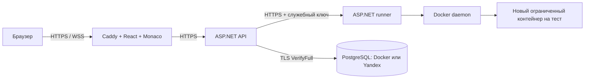

# Запуск на Linux через Docker Compose

## Что подготовлено

Рабочий вариант для одного Linux-сервера: Caddy с React/Monaco, ASP.NET API,
отдельный runner и, по выбору, PostgreSQL в Docker. Можно сохранить нынешнюю
БД Yandex Cloud. API, runner и PostgreSQL общаются с проверкой TLS-сертификатов.
Снаружи открываются только порты веб-сервера 80/443; API, runner и БД не публикуют
свои порты на хост. SignalR проходит через тот же HTTPS-адрес.
У локальной БД отдельный административный пароль; API использует роль interview
без SUPERUSER, CREATEDB и CREATEROLE, владеющую только своей базой.



Файлы:

- `compose.yml` — веб, API, runner, миграции и инструменты обслуживания.
- `compose.postgres.yml` — добавляет собственную PostgreSQL и ожидание её готовности.
- `deploy/Dockerfile.*` — сборка каждого приложения.
- `deploy/setup.sh` — подготовка случайных секретов и внутренней PKI.
- `deploy/Prepare-YandexDeployment.ps1` — перенос нынешнего Windows-подключения и ключей.
- `.env.example` — только несекретные настройки. Пароли находятся в `.deploy`.

## Требования к серверу

Linux, Docker Engine с плагином `docker compose`, доступ к официальным реестрам
при первой сборке. Node, .NET SDK и PostgreSQL на сам сервер устанавливать не нужно.
Начни с VM с 4 CPU, 8 ГБ RAM и свободным диском от 20 ГБ; размер зависит от данных
и кеша образов. Сборка образа sandbox устанавливает семь компиляторов/интерпретаторов.
Текущий runner выполняет одно задание за раз.

Для обычного HTTPS укажи домен, направь его DNS A/AAAA на сервер и разреши TCP
80/443; UDP 443 необязателен и нужен только HTTP/3. Caddy получает и обновляет
публичный сертификат автоматически. Если AAAA указывает не на этот сервер, исправь
его до запуска. Наличие домена и доступ к твоему серверу автоматически не настраиваются.

## Вариант 1: новая PostgreSQL в Docker

Это новая пустая база. Существующие интервью из Yandex сами сюда не копируются.

Перенеси исходники проекта на сервер, например в `/srv/visual-interview`,
затем из корня проекта выполни:

```bash
bash deploy/setup.sh
```

Команда создаст `.env` и каталог `.deploy`. Отредактируй `.env`:

```dotenv
COMPOSE_FILE=compose.yml:compose.postgres.yml
COMPOSE_PATH_SEPARATOR=:
DOMAIN=interview.example.com
HTTP_PORT=80
HTTPS_PORT=443
```

Вместо `interview.example.com` нужен твой домен. `LOCAL_UID/LOCAL_GID` заполняет
setup; остальные сетевые настройки можно оставить. Если Docker сообщает о
пересечении подсетей, согласованно измени APP_SUBNET и WEB_INTERNAL_IP.

```bash
# Собрать подготовленный образ для программ кандидатов.
docker compose --profile tools build sandbox

# Собрать и запустить весь стек; миграции выполнятся до API.
docker compose up --build -d --wait

# Посмотреть состояние и журнал.
docker compose ps -a
docker compose logs --tail=100 api runner web

# Один раз создать первого администратора.
bash deploy/bootstrap-admin.sh
```

Скрипт спросит email. Пароль случайно сгенерирован setup и не выводится
автоматически. Посмотреть его локально можно командой `cat .deploy/bootstrap_password`.
Не публикуй этот файл. Последующих сотрудников создаёт администратор в React.

Открой `https://твой-домен`. Для обычного запуска уже собранного стека достаточно
`docker compose up -d --wait`. Для остановки — `docker compose down`.
**Не добавляй `-v`: этот флаг удаляет постоянные тома с БД и ключами.**

## Вариант 2: сохранить текущую Yandex Cloud БД

В этом варианте PostgreSQL остаётся в Yandex, а фронтенд, API и runner работают
на Linux в Docker. Уже созданные пользователи, задачи и интервью сохраняются.

### Подготовить на нынешнем Windows-компьютере

В корне проекта, в PowerShell с установленными Docker Desktop и .NET SDK 10:

```powershell
Copy-Item .env.example .env
docker compose --profile tools build setup
docker compose --profile tools run --rm setup
.\deploy\Prepare-YandexDeployment.ps1
```

Последняя команда:

1. Читает уже проверенное подключение из user-secrets.
2. Меняет только путь CA для контейнера и записывает строку в `.deploy/database_connection`.
3. Копирует Yandex CA из `root.crt` в `.deploy/database_ca.crt`.
4. Экспортирует ключи Data Protection из Windows DPAPI под новый PFX, сохраняя
   исходные ID и содержимое ключей. Исходное хранилище Windows не заменяется.
5. Проверяет расшифрование старого контрольного значения новыми ключами.
6. Устанавливает `COMPOSE_FILE=compose.yml`, чтобы не поднимать пустую локальную БД.

Рабочая БД при этой подготовке не изменяется. Экспорт не выводит пароли или
открытые мастер-ключи. Нельзя просто скопировать DPAPI-XML на Linux: он не сможет
расшифровать Windows-защиту. Автоэкспорт отозванных ключей запрещён; для такого
случая требуется отдельное сохранение политики отзыва.

### Перенести и запустить на Linux

Перенеси исходники, **`.env` и весь `.deploy`**, включая `imported-keys`, по SSH/SCP.
`.deploy` содержит действующие секреты: не добавляй его в git и не передавай
через публичный файлообменник. На Linux ограничь доступ к каталогу:

```bash
chmod 700 .deploy
```

В `.env` укажи реальный DOMAIN и убедись, что `COMPOSE_FILE=compose.yml`.
Разреши подключение к Yandex PostgreSQL с IP нового сервера на 6432.
Для этого варианта локальный сервис `db` вообще не создаётся.

**Перед переключением останови старый Windows API** через Ctrl+C: реестр
редактора и обработчик очереди рассчитаны на один экземпляр. Браузеры после
переключения войдут заново на новом домене. Docker runner на сервере будет отдельным
от локального Windows runner.

```bash
docker compose --profile tools build sandbox
docker compose build api runner web

# Проверить импорт ключей в Linux без запуска основного API и без изменения БД.
docker compose run --rm --no-deps api dotnet Interview.Api.dll --check-keyring

# Миграции существующей БД, затем запуск приложений.
docker compose up -d --wait
```

Если администратор уже создан в Yandex, повторно bootstrap не запускай: войди
с прежним email/паролем. Не запускай production API с прежней БД, если проверка
импортированных ключей не прошла. При сомнениях оставь старый API остановленным
только на время проверки и верни его до переключения, не запуская два одновременно.

## Локальная проверка Docker без публичного домена

При DOMAIN=localhost Caddy использует собственный локальный CA, которому браузер
изначально не доверяет. Это не публичный сертификат сервера. Для проверки curl
получи CA Caddy и укажи его явно; в браузере доверие настраивается отдельно.

```bash
docker compose cp web:/data/caddy/pki/authorities/local/root.crt ./caddy-local.crt
curl --cacert ./caddy-local.crt https://localhost/health/ready
```

Публичный домен с корректным DNS получает обычный доверенный сертификат;
отключать проверку TLS у API, runner или браузера для сервера не требуется.

## Где сохраняются данные и ключи

| Место | Содержимое |
|---|---|
| Том postgres_data | Данные своей PostgreSQL; в Yandex-варианте отсутствует |
| Том api_keys | Рабочий key ring, защищённый keyring.pfx |
| Тома caddy_data/caddy_config | HTTPS-сертификаты сайта и состояние Caddy |
| `.deploy/keyring.pfx`, `keyring_password` | Защита мастер-ключей шифрования БД |
| `.deploy/database_connection`, `database_ca.crt` | Подключение к выбранной БД и её CA |
| `.deploy/runner_key` | Общий ключ API и runner |
| `.deploy/ca.*`, сертификаты api/runner/db | Внутренняя PKI контейнеров |
| `.deploy/bootstrap_password` | Только пароль начального администратора новой БД |

setup не перезаписывает существующие секреты. Не генерируй новый keyring.pfx
для старого тома ключей. Доступ к зашифрованным данным требует и БД, и её key ring,
и сертификата с паролем. Сохраняй их вместе, но ограничивай доступ к резервным копиям.

## Резервное копирование и обновление

Для своей PostgreSQL пример резервной копии на Linux:

```bash
mkdir -p backups
chmod 700 backups
docker compose stop api
docker compose exec -T db pg_dump -U interview -d interview -Fc > backups/database.dump
docker compose run --rm --no-deps --entrypoint tar api -czf - -C /var/lib/interview keys > backups/keys.tar.gz
tar -czf backups/deployment-secrets.tar.gz .deploy .env
docker compose up -d --wait
```

Для Yandex создай снимок/резервную копию средствами сервиса и отдельно сохрани
key ring, `.deploy` и `.env`. Резервные копии нельзя публиковать вместе с исходниками.

При обновлении исходников сначала сделай резервную копию, затем
`docker compose up --build -d --wait`. Миграции выполняет отдельный контейнер
`migrate`; API ждёт его успешного завершения. У ошибочной миграции смотри журнал
`docker compose logs migrate`, не удаляй тома для исправления ошибки.
Внутренние TLS-сертификаты setup действуют 825 дней, CA и сертификат key ring —
10 лет. Планируй их обновление заранее с сохранением прежнего сертификата
расшифрования key ring; HTTPS-сертификаты публичного сайта обновляет Caddy.

## Границы безопасности

Docker socket смонтирован **только в доверенный runner**. Это привилегированный
доступ к Docker-хосту, даже когда процесс runner выполняется как app (UID 1654).
API, веб и контейнеры кандидатов socket не получают. Для публичного исполнения
чужого кода лучше выделить отдельный узел/VM runner и настроить доступ API к нему
по HTTPS; предложенный Compose — вариант для одного сервера, не кластерная оркестрация.

Код кандидата запускается в новых контейнерах без сети и host-монтов, с read-only
корнем, UID 65532, no-new-privileges и лимитами. Контейнеризация разделяет ядро
Docker-хоста и не заменяет независимый аудит безопасности или отдельную VM.
Не публикуй порт runner или Docker API наружу. Локальные Compose secrets — файлы
на хосте, а не внешнее зашифрованное хранилище: доступ администратора хоста остаётся
доверенной границей.

## Что проверено

Linux-контейнеры собраны и запущены на Docker Engine. Проверены миграции на новой
PostgreSQL, HTTPS/проверка CA, Secure-cookie, гостевой вход, WebSocket через Caddy,
код/курсоры/управление, API → HTTPS runner → реальные Docker-тесты, решение,
чат/подсказки, оценки и запись. Перенос Windows DPAPI-ключей проверен в Linux
на контрольном шифротексте без изменения рабочей Yandex БД.
Получение публичного ACME-сертификата на твоём домене требует DNS и сервера:
локальный тест использовал CA Caddy с явным доверием в тестовом клиенте.
Дополнительно прошли 31 серверный тест без пропусков с реальным Docker,
проверка перезапуска с сохранением зашифрованных данных и shell/PowerShell-синтаксиса.
Проверены также 12 тестов фронтенда, обычная production-сборка с локальным Monaco,
полный PowerShell-скрипт подготовки Yandex и реальное TLS-подключение к Yandex
из Linux-контейнера запросом SELECT VERSION() без изменения данных.

Официальные источники:

- [Docker Compose: порядок запуска и healthcheck](https://docs.docker.com/compose/how-tos/startup-order/)
- [Caddy: reverse proxy и WebSocket](https://caddyserver.com/docs/caddyfile/directives/reverse_proxy)
- [Caddy: автоматический HTTPS](https://caddyserver.com/docs/automatic-https)
- [ASP.NET Data Protection: формат ключей](https://learn.microsoft.com/en-us/aspnet/core/security/data-protection/implementation/key-storage-format?view=aspnetcore-10.0)
